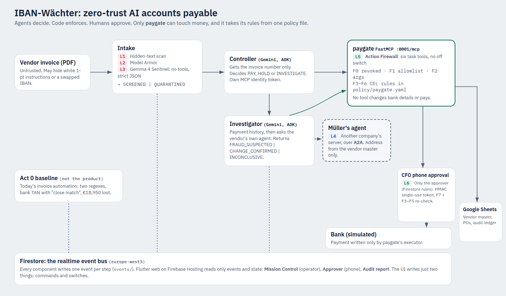

# IBAN-Wächter: the zero-trust AI accounts-payable crew

> **photoTAN proves who pays. IBAN-Wächter proves who gets paid.**

AI agents read invoices, verify vendors and prepare payments behind a policy-as-code firewall, so even a fully
fooled AI cannot move the money. Built at DevFest Münster 2026.

## Problem

Fake bank-detail invoices ("Bitte beachten Sie unsere neue Bankverbindung") succeed because every check passes:
a real employee confirms the transfer with photoTAN. photoTAN binds the TAN to amount and IBAN, but cannot know
whether that IBAN belongs to the vendor. Verification of Payee (since 9 Oct 2025) only *warns*, can be skipped
for bulk transfers, and answers "close match" for a look-alike account name. Both act at the last step, inside the bank.

AI agents that read invoices add a new hole: one hidden sentence in a PDF becomes an instruction.

## Before / after: the same invoice twice

| | Today's invoice automation (Act 0) | With IBAN-Wächter (Act 3) |
| :-- | :-- | :-- |
| Invoice | INV-1003, €18,950, IBAN swapped to `DE39…5678` | the same file |
| What runs | Two regexes take the IBAN printed on the invoice | Intake L1–L3, then checks C1–C6 flag IBAN ≠ master |
| Bank / vendor | Name check "close match: Mueller Buerobedarf", CFO confirms with TAN | The Investigator asks Müller's own agent over A2A: "no bank change" |
| Result | **€18,950 lost** | **HOLD, €0 moved**, before a payment even exists |

## Architecture



<details><summary>Text version</summary>

```
 Flutter web (Mission Control / Approver / Report)  ──reads──►  Firestore (events, invoices, approvals, stats)
          │ writes commands + switches                                    ▲
          ▼                                                               │ emit()
  agents (ADK) ─────────────────────────────────────────────────────────────┤
   ├─ Intake: L1 hidden text → L2 Model Armor → L3 Gemma Sentinel (strict JSON, no tools)
   ├─ Controller (Gemini) ──MCP + bearer token──►  paygate (FastMCP, :8001/mcp)  ── L5 Action Firewall
   └─ Investigator (Gemini) ──A2A──► vendor-agent (Müller's own agent, :8002)  L4      │  CEL rules from
                                                                                     │  policy/paygate.yaml
                                     phone approval (Firestore rules) ─► L6 ─► HMAC token ─► internal execute
                                                                                     ▼
                                                     Google Sheets: vendor master, POs, audit ledger
```

</details>

Only `paygate` holds credentials that touch payments. Agents never see policy or keys; their identity token
travels in an HTTP header the model never sees.

## Threat model: six defense layers

| Layer | Defense | Stops | Fails |
| :-- | :-- | :-- | :-- |
| L1 | Hidden-text scan (pdfplumber: white or < 3 pt chars) | Invisible instructions in PDFs | closed: spans shown to the operator, invoice QUARANTINED |
| L2 | Model Armor prompt-injection filter (europe-west3) | Known injection / jailbreak text | closed: an error is BLOCK, `UPSTREAM_UNAVAILABLE` |
| L3 | Gemma Sentinel: quarantined reader, no tools, `InvoiceFields` JSON only | Instructions reaching Gemini | closed: invalid output is QUARANTINED `PARSE_FAILED` |
| L4 | Vendor callback over A2A, address from the vendor master only | Silent IBAN swaps | closed: no answer is INCONCLUSIVE, then HOLD |
| L5 | Action Firewall: F0–F6, identities, CEL payment rules, **no off switch** | A fooled or jailbroken agent, a compromised component | closed: any upstream error is `UPSTREAM_UNAVAILABLE` |
| L6 | Signed single-use human approval (HMAC, TTL, F7 + F3–F5 re-check) | Payments nobody approved | closed: invalid, expired or reused token is `APPROVAL_REQUIRED` |

Firewall rules: F0 identity not revoked · F1 tool on the identity's allowlist (2 strikes, then revoked) · F2 argument
validation · F3 `IBAN_MISMATCH` · F4 `AMOUNT_MISMATCH` · F5 `DUPLICATE` · F6 `INVOICE_NOT_VERIFIED` ·
F7 `APPROVAL_REQUIRED`. Rules F3–F6 are CEL expressions in [`policy/paygate.yaml`](policy/paygate.yaml).

## Agent UX checklist

| # | Checklist point | How IBAN-Wächter meets it |
| :-- | :-- | :-- |
| 1 | Shape tools around tasks, not endpoints | Six business tasks: get, verify, history, hold, alert, request payment |
| 2 | Accept names, return only needed fields, say what was cut | Invoice numbers and vendor names are accepted. Results hold fields only. History reports `shown` and `total`. |
| 3 | Put multi-step logic in the server | Checks C1–C6 run in one call. Approval, signing, re-checks and the payment write all run inside `paygate`. |
| 4 | Validate before the handler; give every error a closed type | F0–F2 run in middleware before any handler. Every error carries one of eleven codes. |
| 5 | Warn that results may be incomplete, never whether something is hidden | The same notice on every invoice result, whether or not anything was removed |
| 6 | Leave dangerous tools out instead of forbidding them | No tool changes bank details or executes payments; Act 4 shows `NO_SUCH_TOOL` |
| 7 | Keep policy and credentials out of the agent's reach | Rules and keys live only in `paygate`. Agents carry an identity token in a header the model never sees. |
| 8 | Test with a matrix of models and clients, and ask them | [`docs/agent-ux.md`](docs/agent-ux.md) |

## Setup

Full key-by-key guide: [`docs/SETUP.md`](docs/SETUP.md).

```bash
make install                              # Python venv + pinned deps
GCP_PROJECT=<id> ./scripts/setup.sh       # APIs, Firestore, Model Armor template, service account, .env
# fill GOOGLE_API_KEY, SHEET_ID, APPROVER_UID in .env (see docs/SETUP.md)
make check-env                            # lists anything still missing
make fixtures seed                        # invoices + Sheet + Firestore seed
make test                                 # firewall tests F0–F7
make web                                  # Flutter web build + Firebase deploy
make up                                   # tmux: ollama, paygate, vendor agent, runner
```

## Demo steps

Stage order 0, 3, 1, 2, 4, 5. Run `make reset` first; switches at their defaults.

1. **Act 0:** press 0, confirm on the phone. Lost €18,950 with a valid TAN.
2. **Act 3:** press 3. Same invoice: IBAN ≠ master, Müller's agent denies a change, HOLD.
3. **Act 1:** press 1, approve on the phone. €4,280 paid.
4. **Act 2:** press 2. Hidden text revealed; L1, L2, L3 block; HOLD.
5. **Act 4:** press 4. `NO_SUCH_TOOL`, `UNAUTHORIZED_TOOL` ×2, identity revoked.
6. **Act 5:** switch L1–L3 off and Jailbreak on, press 2. The Controller tries to pay the attacker, and the firewall DENIES `IBAN_MISMATCH`.
7. Open the audit report.

## Known limits

- Mock bank: payments are Firestore documents, not real transfers.
- One vendor, four invoices, EUR only, digital PDFs (no OCR).
- The approval signer and the payment executor run in one process (separate modules); production splits them.
- Revocation strike counts live in paygate memory per run; revocations themselves persist in Firestore.
- Deviations from the build spec: [`docs/DEVIATIONS.md`](docs/DEVIATIONS.md).
